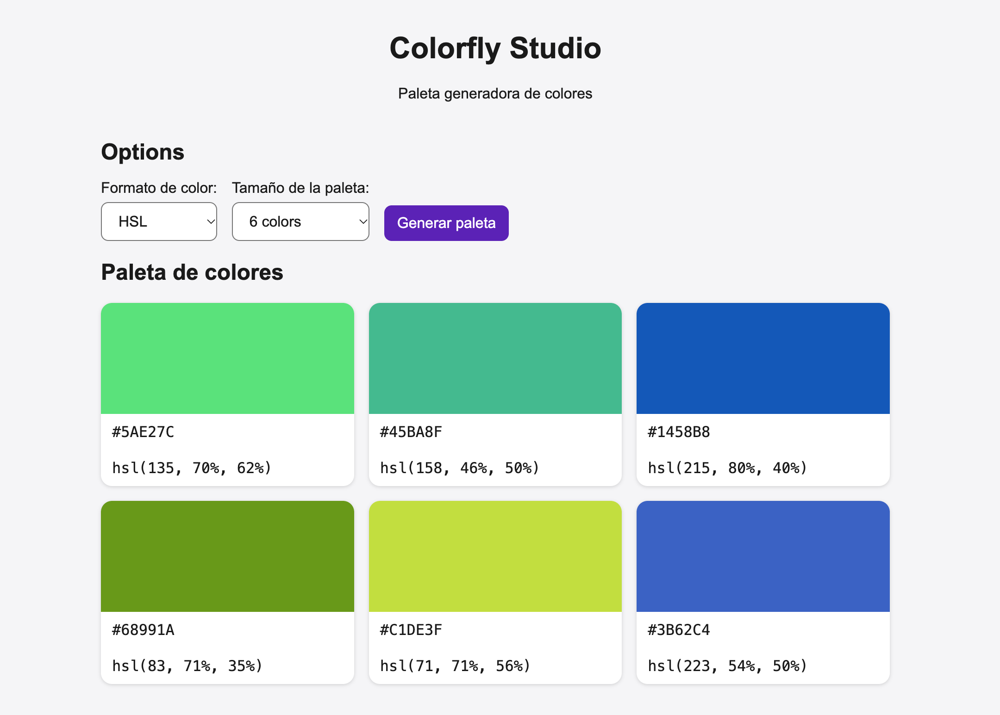

# Generador de paletas - Colorfly Studio

Es una página web que crea paletas de colores al azar con un solo botón.
La hice para el equipo de Colorfly Studio, para que tengan ideas de colores rápido cuando preparan propuestas para sus clientes.

**Ver la página:** https://edanielgr95-glitch.github.io/ProyectoM1_DanielGomez/



## Cómo se usa

1. Elige el formato de color: HSL o HEX.
2. Elige cuántos colores quieres: 6, 8 o 9.
3. Pulsa "Generar paleta".
4. Aparecen las tarjetas con los colores. Cada una muestra su código HEX. Si elegiste HSL, también muestra el código HSL.
5. Abajo sale un aviso que dice que la paleta se generó.

Cuando abres la página ya aparece una paleta, para que se vea de una vez qué hace.

## Cómo abrirlo en tu computadora

1. Descarga el proyecto desde GitHub con el botón verde "Code", o con este comando en la terminal:

   ```bash
   git clone https://github.com/edanielgr95-glitch/ProyectoM1_DanielGomez.git
   ```

2. Abre el archivo `index.html` con el navegador. No hay que instalar nada.

## Cómo lo publiqué

Usé GitHub Pages, que convierte los archivos del repositorio en una página que cualquiera puede abrir con un enlace. Cada vez que subo cambios con `git push`, la página se actualiza sola en uno o dos minutos.

## Archivos del proyecto

- `index.html`: lo que se ve en la página (títulos, listas y botón).
- `styles.css`: el diseño (colores, tamaños y las tarjetas).
- `script.js`: lo que hace funcionar el botón y crea los colores.
- `docs/capturas`: capturas de la página.
- `docs/ia`: cómo usé la IA en el proyecto.

## Decisiones que tomé

- **Separé el proyecto en tres archivos.** Cada uno tiene un solo trabajo, y así es más fácil encontrar dónde está un error.
- **Usé `header`, `main` y `footer` en vez de solo `div`.** Así se entiende qué es cada parte de la página: el encabezado, el contenido y el pie.
- **El código HEX se ve siempre, aunque elijas HSL.** Lo pide la consigna. Para eso hice una función que convierte un color HSL a HEX.
- **Puse límites a los colores HSL.** Si un color es muy oscuro se ve negro, si es muy claro se ve blanco, y si no tiene intensidad se ve gris. Con los límites, cada color de la paleta se distingue de los demás.
- **El código está en inglés y los textos de la página en español.** Al principio mezclé los dos idiomas en la página y después lo corregí.

## Accesibilidad

Accesibilidad significa que la página la pueda usar cualquier persona.

- Cada lista tiene su texto conectado: si haces clic en "Tamaño de la paleta", se activa la lista.
- Los textos se leen bien: oscuros sobre fondo claro, y blancos sobre el botón violeta.
- Si navegas solo con la tecla Tab, un borde te muestra dónde estás. Sirve a quien no puede usar el mouse.
- El aviso lo pueden escuchar las personas que usan un lector de pantalla.

## Lo que aprendí

Empecé este proyecto sin saber HTML, CSS ni JavaScript, y terminé con una página que funciona y está publicada.

- **JavaScript fue lo que más me costó.** Aprendí a leer los errores de la consola: el mensaje y el número de línea dicen dónde está el problema. Por ejemplo, escribí `funtion` en vez de `function` y nada funcionaba.
- **Los nombres tienen que ser iguales en todos los archivos.** Puse `color-swatch` en el HTML y `.swatch` en el CSS, y el color no aparecía hasta que los igualé.
- **Hacer commits pequeños.** Guardar cada avance por separado me dejó revisar qué cambié en cada paso. Así encontré un detalle del pie de página que me faltaba corregir.

## Lo que le agregaría después

- Copiar el código de un color al hacer clic.
- Bloquear los colores que me gustan para que no cambien al generar otra paleta.
- Guardar las paletas para no perderlas al cerrar la página.
- Que se vea bien en el celular.

## Uso de IA

Usé IA como tutor durante el proyecto. Cómo la usé y qué hice con sus respuestas está en [docs/ia/uso-de-ia.md](docs/ia/uso-de-ia.md).

## Autor

Daniel Gomez - Proyecto M1
